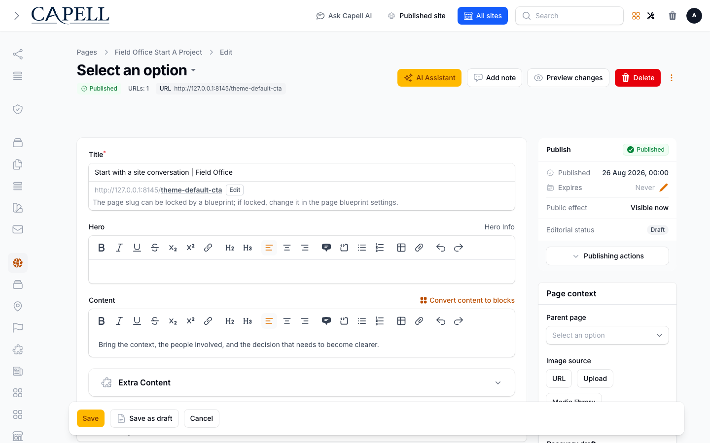
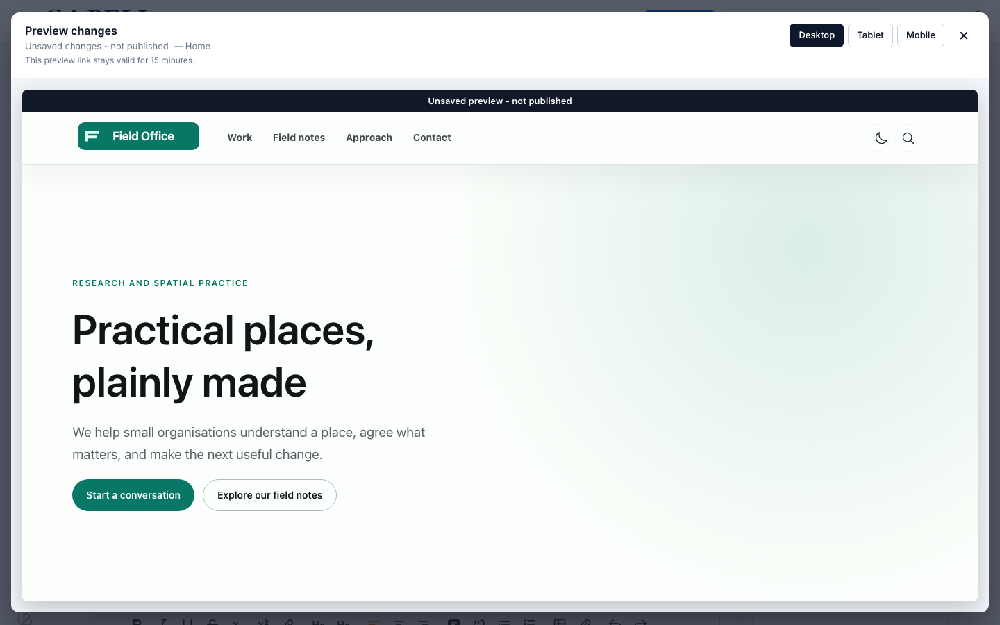

# Filament Peek

<!-- prettier-ignore-start -->

## What It Does

Filament Peek stores a private, per-user snapshot of unsaved page and Layout Builder state and renders it through an expiring signed preview route.

- **Price and availability:** Check current availability and price on the [Capell Marketplace listing](https://capell.app/extensions/filament-peek).
- **Licence:** Check the licence terms on the [Capell Marketplace listing](https://capell.app/extensions/filament-peek).
- **Requires:** `PHP ^8.4`, `capell-app/admin ^1.0.66`, `capell-app/core ^1.0.71`, `capell-app/frontend ^1.0.72`, `laravel/framework ^12.41.1|^13.0`, `lorisleiva/laravel-actions ^2.8`, `pboivin/filament-peek ^4.0`, `spatie/laravel-data ^4.5`, `spatie/laravel-package-tools ^1.14.1`.
- **Install:** `composer require capell-app/filament-peek`.

Editors open an unsaved preview from the page edit action and can check device presets before saving. Missing or expired snapshots return a private error rather than exposing preview state.

## Who It Is For

**For developers:** Snapshot creation, lookup, state storage, and rendering are separate Actions behind typed data and a preview-state contract, with no database schema required.

**For teams:** Editors can review unsaved copy, media, and layout changes in the active theme before deciding whether to save or publish them.

## Quick Start

1. Install the package: `composer require capell-app/filament-peek`.
2. Run `php artisan route:list` and verify the package routes are registered.

## Configure

- **Configuration files:** `config/capell-filament-peek.php`.

## Limits And Pitfalls

- Install the required Capell packages at the versions in `composer.json`: `capell-app/admin ^1.0.66`, `capell-app/core ^1.0.71`, `capell-app/frontend ^1.0.72`.
- Review middleware, throttling, signatures, and public-output safety in `routes/web.php` before exposing routes.
- Keep public Blade and cached HTML free of authoring markers, model IDs, permissions, signed editor URLs, and lazy database queries.
- Custom write integrations must preserve invalidation for `filament-peek-preview` cache tags.

## Screens And Workflow

- Page edit preview actions (admin).
- Redesigned unsaved preview modal, desktop (admin).
- Labelled Desktop, Tablet, and Mobile device controls (admin).
- Rotating the Mobile preview to landscape (admin).
- Page edit preview actions with admin sidebar menu open (admin).

## Install Impact

- Required packages: `capell-app/admin`, `capell-app/core`, `capell-app/frontend`.
- Admin navigation: no admin page or resource contribution is declared.
- Admin/editor extensions: none declared.
- Permissions: no package permission declarations or Shield gates detected; host access rules still apply.
- Public routes: loads `routes/web.php`; registers `FilamentPeekRoutesContribution`.
- Database changes: no package migrations declared.
- Config: `config/capell-filament-peek.php`.
- Settings: no package settings declared.
- Queues or schedules: none declared.
- Cache tags: `filament-peek-preview`.
- Commands: none declared.

## Troubleshooting

| Symptom | Likely cause | Check | Fix |
| --- | --- | --- | --- |
| Package surface is missing after install | Provider or manifest is not loaded | Confirm `capell.json`, package `composer.json`, and provider registration | Reinstall the package, refresh Composer autoload, and clear host caches |
| Route returns unexpected output | Route cache, middleware, or signed URL setup does not match the package route file | Check the route files listed in `Technical Shape` | Clear route cache and verify middleware before exposing public routes |
| Public output leaks unexpected state | Render data, cache variation, or authoring boundary has regressed | Check public Blade, cache tags, and public-output safety tests | Move data loading out of Blade and rerun the package public-output tests |

## Upgrading

No manual steps between minor versions.

Read [CHANGELOG.md](CHANGELOG.md) before upgrading.

## Next Steps

- [Package docs](docs/README.md)
- [Overview](docs/overview.md)
- [Worked extension examples](docs/extension-contracts.md)
- Configuration files: [`config/capell-filament-peek.php`](config/capell-filament-peek.php).
- [Troubleshooting](#troubleshooting)
- [Developer reference](docs/reference.md)
- [Marketplace assets](docs/assets/marketplace/)
- [Capell content language plan](../../docs/CONTENT_LANGUAGE_PLAN.md)
- [Capell documentation design system](../../docs/DESIGN_SYSTEM.md)
- [Capell and package ERD notes](../../docs/erd/capell-and-package-erds.md)
- Related packages: [Layout Builder](../layout-builder/README.md), [Publishing Studio](../publishing-studio/README.md).

<!-- prettier-ignore-end -->
